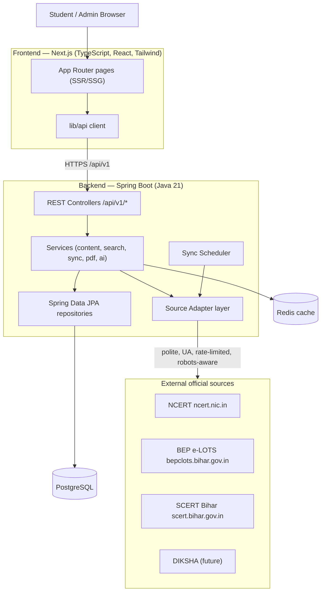
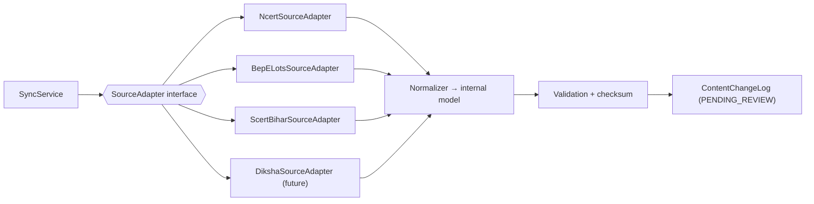
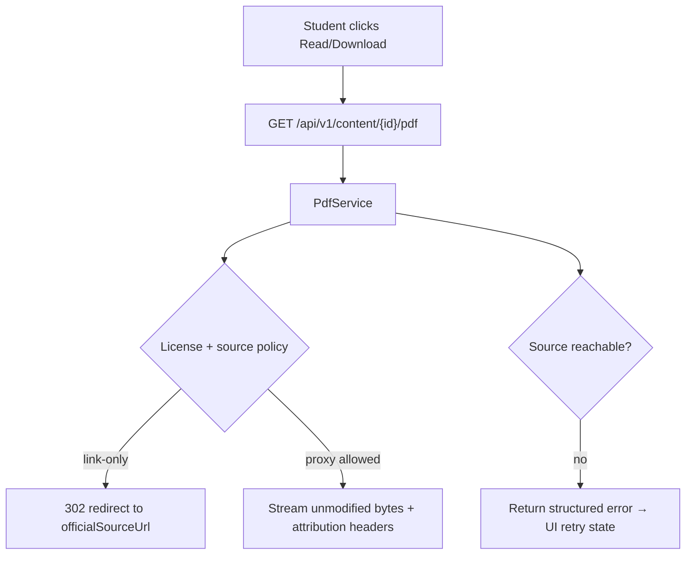
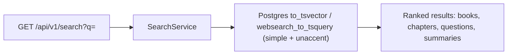
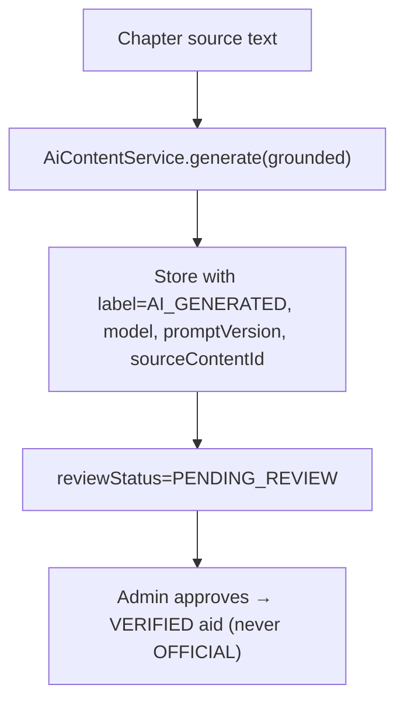
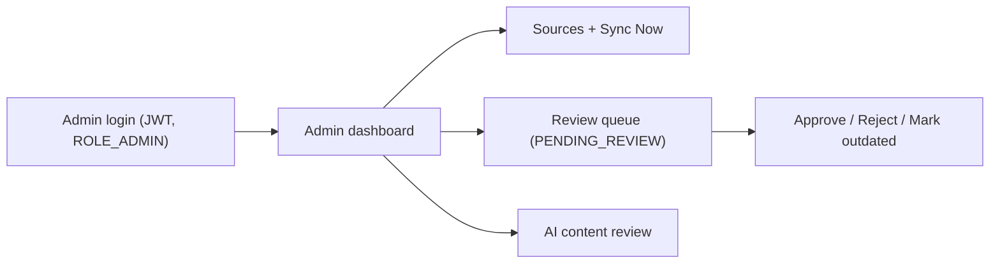
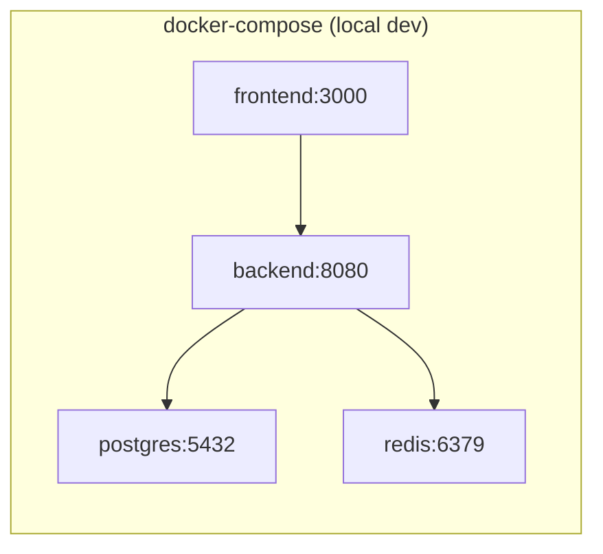

# Architecture — Bihar Class IX Student Learning Platform

**Status:** Phase 3 deliverable. See also `data-model.md`, `api.md`, `source-research.md`,
`content-policy.md`.

## 1. High-level system



**Principle:** the frontend never calls external government sites directly. All content flows
through the backend content API, which owns adapters, caching, and provenance.

## 2. Component responsibilities

- **Frontend (Next.js):** rendering, routing, SEO metadata, PDF reader UI, search UI, responsive
  + accessible components. Talks only to our API.
- **Controllers:** thin HTTP layer, validation, consistent error envelope, OpenAPI annotations.
- **Services:**
  - `ContentService` — classes/subjects/books/chapters/syllabus read model.
  - `SearchService` — PostgreSQL full-text search (pluggable to OpenSearch).
  - `PdfService` — resolves a chapter/book PDF to a redirect (deep link) or an unmodified proxy
    stream, with attribution headers; handles errors/retry semantics.
  - `SyncService` + `SourceAdapter`s — discovery, metadata extraction, normalization, checksum
    compare, versioning, change log, cache invalidation, re-index. Disabled by default.
  - `AiContentService` — grounded, clearly-labelled learning aids (pluggable provider; off by
    default in v1).
  - `TextToSpeechProvider` — pluggable interface, no hard external dependency in v1.
- **Repositories/JPA → PostgreSQL:** normalized schema (see data-model).
- **Redis:** caches hot read models (classes, subjects, books, chapters, syllabus) with TTLs.

## 3. Source adapter layer



Each adapter normalizes its source's shape into the common `SourceContentDescriptor` model, so
adding a source does not change downstream code.

## 4. Content sync flow

```mermaid
sequenceDiagram
  participant Adm as Admin
  participant API as Sync API
  participant Sync as SyncService
  participant Ad as SourceAdapter
  participant Ext as Official Source
  participant DB as PostgreSQL
  participant Ch as Redis
  Adm->>API: POST /admin/sources/{id}/sync (RBAC)
  API->>Sync: run(sourceId)
  Sync->>Ad: discover()
  Ad->>Ext: fetch listing (polite, UA, backoff)
  Ext-->>Ad: HTML / PDF metadata
  Ad-->>Sync: descriptors + checksums
  Sync->>DB: compare versions, write ContentChangeLog(PENDING_REVIEW)
  Note over Sync,DB: never auto-overwrite OFFICIAL; new version pending
  Adm->>API: approve change
  API->>DB: promote to OFFICIAL, bump contentVersion
  API->>Ch: invalidate cache
  API->>Sync: reindex search
```

## 5. PDF flow



## 6. Search flow



## 7. AI content flow



## 8. Admin flow



## 9. Technology & deployment

- Frontend: Next.js 14 (App Router), TypeScript, Tailwind, `pdf.js` based reader.
- Backend: Java 21, Spring Boot 3 (Web, Data JPA, Security, Validation, Actuator), springdoc
  OpenAPI, Flyway.
- Data: PostgreSQL 16 (+ `unaccent`), Redis 7.
- Containerized with Docker; `docker-compose.yml` for local; Kubernetes-compatible for prod.



## 10. Extensibility (VI–XII)

Adding a class/subject/source is **data + config**: insert `classes`/`subjects` rows and (if
needed) register a new `SourceAdapter` bean. No page redesign — frontend reads the class/subject
catalogue from the API and renders generically.
