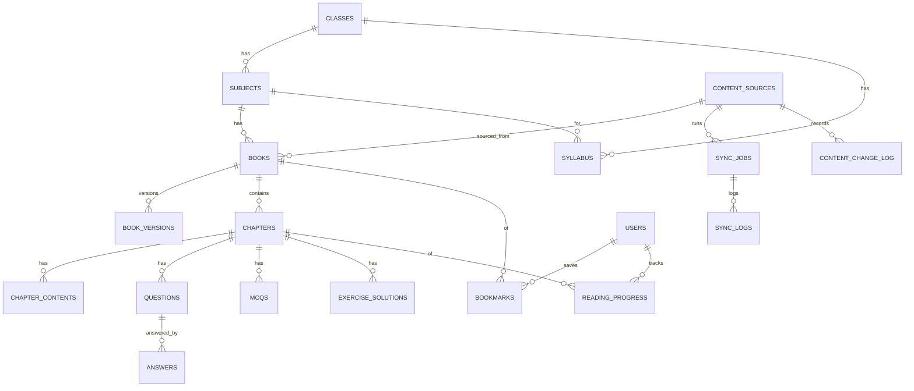

# Data Model — Bihar Class IX Student Learning Platform

**Status:** Phase 3 deliverable. Implemented by Flyway migrations in Phase 4.
Database: PostgreSQL. UUID primary keys. Provenance is first-class.

## 1. Entity relationship (core)

## 2. Provenance (embedded on content-bearing rows)

Columns present on `books`, `chapters`, `chapter_contents`, `syllabus`, `questions`, `answers`,
`mcqs`, `exercise_solutions`:

| column | type | notes |
|--------|------|-------|
| source_type | enum | OFFICIAL_GOV, NCERT, SCERT, DIKSHA, THIRD_PARTY, AI_GENERATED, DEMO |
| source_name | text | e.g. "NCERT", "BEP e-LOTS" |
| source_url | text | human page |
| source_document_url | text | direct PDF/doc |
| retrieved_at | timestamptz | nullable |
| published_at | timestamptz | nullable |
| academic_year | text | e.g. "2026-27", nullable |
| version | int | content version, default 1 |
| checksum | text | sha-256 of source doc, nullable |
| license | text | e.g. "CC BY-NC-ND 4.0", nullable |
| verification_status | enum | OFFICIAL, VERIFIED, THIRD_PARTY, AI_GENERATED, PENDING_REVIEW, OUTDATED |

**Unverified fields are `null`, never fabricated.**

## 3. Tables

### classes
`id uuid pk`, `code text unique` (e.g. "9"), `name text` ("Class IX"), `display_order int`,
`is_active bool` (MVP: only 9 true), `created_at`, `updated_at`.

### subjects
`id uuid pk`, `class_id fk`, `code text`, `name text`, `name_hi text null`, `icon text null`,
`language text`, `medium text null`, `academic_year text null`, `display_order int`,
`created_at`, `updated_at`. Unique `(class_id, code)`.

### content_sources
`id uuid pk`, `key text unique` (NCERT/BEP_ELOTS/SCERT/DIKSHA), `name text`, `authority_tier int`
(1/2/3), `base_url text`, `adapter_bean text`, `enabled bool default false`,
`robots_confirmed bool default false`, `license_default text null`, `last_checked_at tz null`,
`last_success_at tz null`, `created_at`, `updated_at`.

### books
`id uuid pk`, `subject_id fk`, `source_id fk null`, `slug text unique`, `title text`,
`subtitle text null`, `board text null`, `publisher text null`, `language text`,
`medium text null`, `edition text null`, `isbn text null`, `cover_image text null`,
`pdf_url text null`, `official_source_url text null`, `description text null`,
`chapter_count int default 0`, `status text` (DRAFT/PUBLISHED/OUTDATED), `last_updated tz null`,
+ provenance columns, `created_at`, `updated_at`.

### book_versions
`id uuid pk`, `book_id fk`, `version int`, `snapshot jsonb`, `change_type text`,
`created_at`. Audit of book metadata over time.

### chapters
`id uuid pk`, `book_id fk`, `chapter_number int`, `slug text`, `title text`, `title_hi text null`,
`description text null`, `source_page_start int null`, `source_page_end int null`,
`pdf_reference text null`, + provenance, `created_at`, `updated_at`. Unique `(book_id, chapter_number)`.

### chapter_contents
`id uuid pk`, `chapter_id fk`, `content_type enum` (SUMMARY, KEY_CONCEPTS, DEFINITIONS,
IMPORTANT_POINTS, REVISION, FORMULAS), `body text`, `language text`, `is_ai bool default false`,
+ provenance (+ ai fields below when is_ai), `created_at`, `updated_at`.

### questions
`id uuid pk`, `chapter_id fk`, `category enum` (MCQ, VERY_SHORT, SHORT, LONG, IMPORTANT,
PREVIOUS_EXAM), `text text`, `marks int null`, `difficulty text null`, + provenance,
`created_at`, `updated_at`. (PREVIOUS_EXAM only when verification_status=VERIFIED.)

### answers
`id uuid pk`, `question_id fk`, `text text`, `is_ai bool`, + provenance (+ ai fields),
`created_at`, `updated_at`.

### mcqs
`id uuid pk`, `chapter_id fk`, `question text`, `options jsonb` (array), `correct_index int`,
`explanation text null`, + provenance, timestamps.

### exercise_solutions
`id uuid pk`, `chapter_id fk`, `exercise_ref text`, `problem text null`, `solution text`,
`is_ai bool`, + provenance, timestamps.

### syllabus
`id uuid pk`, `class_id fk`, `subject_id fk null`, `title text`, `body text null`,
`document_url text null`, + provenance, timestamps.

### AI metadata (columns on ai-bearing rows / or `ai_content_meta` side table)
`generated_at tz`, `model text`, `source_content_id uuid`, `prompt_version text`,
`review_status enum` (PENDING_REVIEW, VERIFIED, REJECTED).

### sync_jobs
`id uuid pk`, `source_id fk`, `status enum` (QUEUED, RUNNING, SUCCESS, FAILED), `started_at`,
`finished_at null`, `records_discovered int`, `records_updated int`, `records_failed int`,
`triggered_by text`, `created_at`.

### sync_logs
`id uuid pk`, `job_id fk`, `level text`, `message text`, `context jsonb null`, `created_at`.

### content_change_log
`id uuid pk`, `content_id uuid`, `content_table text`, `source_id fk null`, `old_version int null`,
`new_version int null`, `change_type enum` (NEW, UPDATED, REMOVED, RENAMED),
`detected_at tz`, `processed_at tz null`, `status enum` (PENDING_REVIEW, APPROVED, REJECTED),
`diff jsonb null`.

### users (minimal, optional MVP)
`id uuid pk`, `email text unique null`, `display_name text null`, `role enum` (STUDENT, ADMIN),
`password_hash text null`, `created_at`, `updated_at`.

### bookmarks
`id uuid pk`, `user_id fk`, `book_id fk null`, `chapter_id fk null`, `created_at`.

### reading_progress
`id uuid pk`, `user_id fk`, `chapter_id fk`, `percent int`, `last_page int null`,
`updated_at`.

## 4. Indexes

- `subjects(class_id)`, `books(subject_id)`, `books(slug)`, `chapters(book_id, chapter_number)`,
  `chapters(slug)`, `questions(chapter_id, category)`, `syllabus(class_id, subject_id)`.
- Provenance filters: `books(verification_status)`, `books(academic_year)`,
  `*_contents(verification_status)`.
- Search: GIN on `to_tsvector('simple', unaccent(...))` for books.title/description,
  chapters.title/description, questions.text, chapter_contents.body.
- Sync: `sync_jobs(source_id, status)`, `content_change_log(status)`.

## 5. Multilingual

`name_hi`, `title_hi`, and `language` columns support English/Hindi/Urdu. Translated aids are
stored as separate `chapter_contents` rows with `is_ai`/provenance distinguishing them from
official content.
